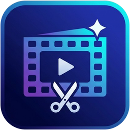
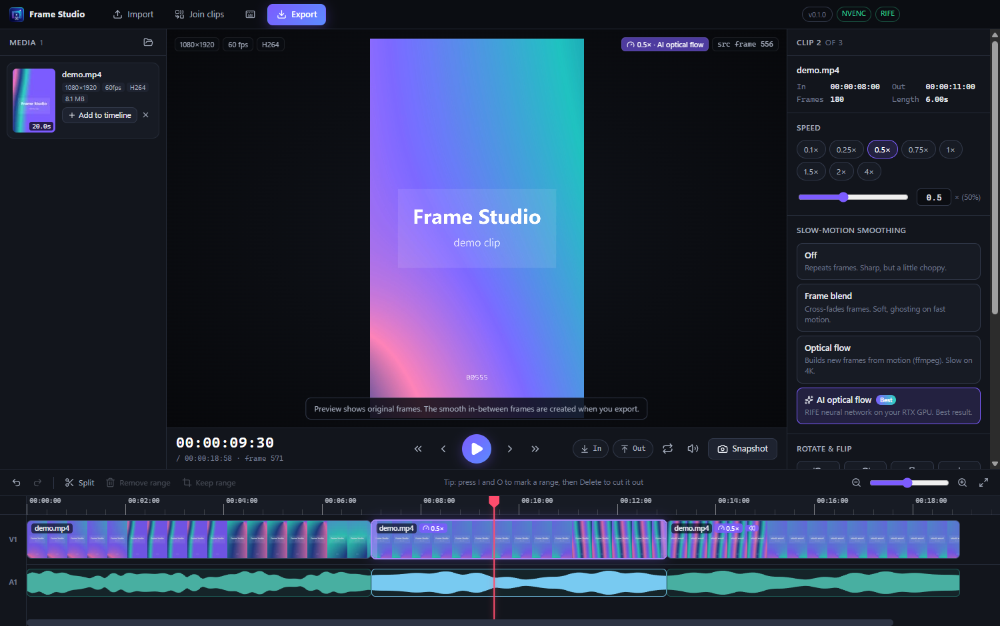
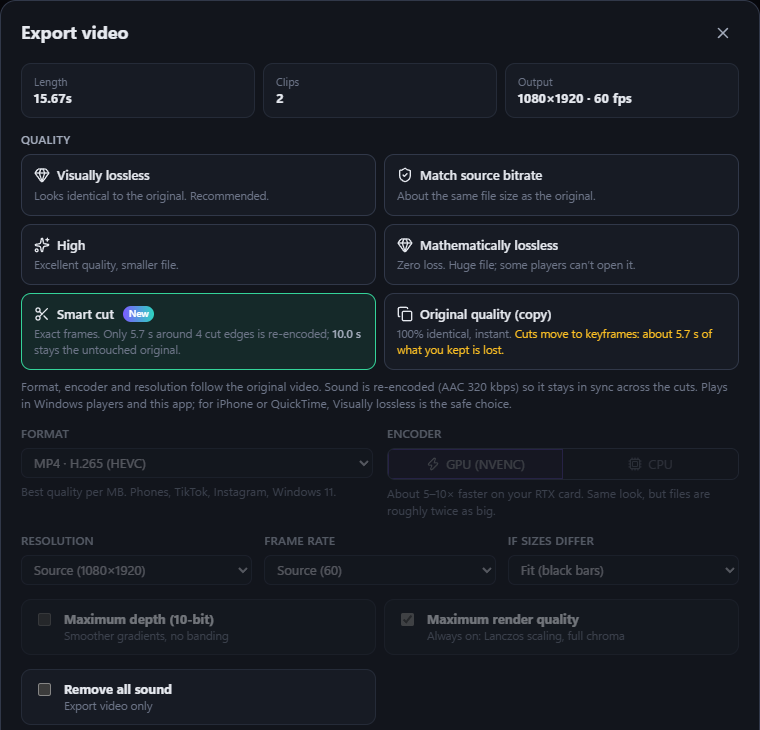

# Frame Studio

**Frame-accurate video editing for Windows, without losing quality.**

## Download

1. Open the **[latest release](https://github.com/alwifearzz17/frame-studio-releases/releases/latest)** and download **`Frame-Studio-Setup-x.y.z.exe`**.
2. Run it. It installs for your Windows user only, no admin needed, and adds Start menu and desktop shortcuts.
3. Windows may show *"Windows protected your PC"* because the installer isn't code-signed yet. Click **More info → Run anyway**.
4. On first start, if your PC doesn't have ffmpeg (the video engine), Frame Studio offers to download it for you (about 200 MB, once).

**Updates are automatic:** when a new version comes out, an **Update** button appears in the app's top bar. Click it and Frame Studio updates itself.

## What it does

- ✂️ **Cut on the exact frame**: timecode like Premiere, frame stepping, split, remove the middle, trim, undo.
- 🎯 **Smart cut**: exact-frame cuts that keep the original video untouched between keyframes.
- 🐢 **Slow motion** with frame blend, optical flow or **AI optical flow (RIFE)** on NVIDIA GPUs.
- 🔁 **Reverse and boomerang** loops with smooth turnarounds.
- 🔄 **Rotate and flip.**
- 📱 **Crop & reframe**: turn a horizontal video into a vertical one (or 4:5, 1:1, 16:9), and drag to keep your subject in frame.
- 🎥 **Follow a person**: pick someone once and the vertical window follows them by itself, like a camera operator. It tells people apart by their whole look, waits when they leave the shot, and shows you where to double-check.
- 📸 **Save any frame** as PNG or JPG.
- 🔗 **Join clips** in one click.
- 💎 **Export without visible quality loss**: visually lossless (VMAF 99.6+), mathematically lossless, or a bit-perfect copy.

## Requirements

Windows 10 or 11 (64-bit). An NVIDIA GPU makes exports much faster and enables AI slow motion; without one, Frame Studio uses the CPU.

---

This repository only hosts the installers. Frame Studio uses <a href="https://ffmpeg.org">FFmpeg</a> (downloaded separately from <a href="https://github.com/BtbN/FFmpeg-Builds">BtbN/FFmpeg-Builds</a>, GPL) , <a href="https://github.com/nihui/rife-ncnn-vulkan">rife-ncnn-vulkan</a> (MIT), <a href="https://github.com/Megvii-BaseDetection/YOLOX">YOLOX</a> (Apache-2.0), <a href="https://github.com/KaiyangZhou/deep-person-reid">OSNet / Torchreid</a> (MIT) and <a href="https://onnxruntime.ai">ONNX Runtime</a> (MIT).
